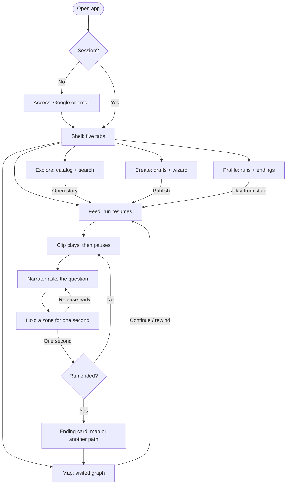
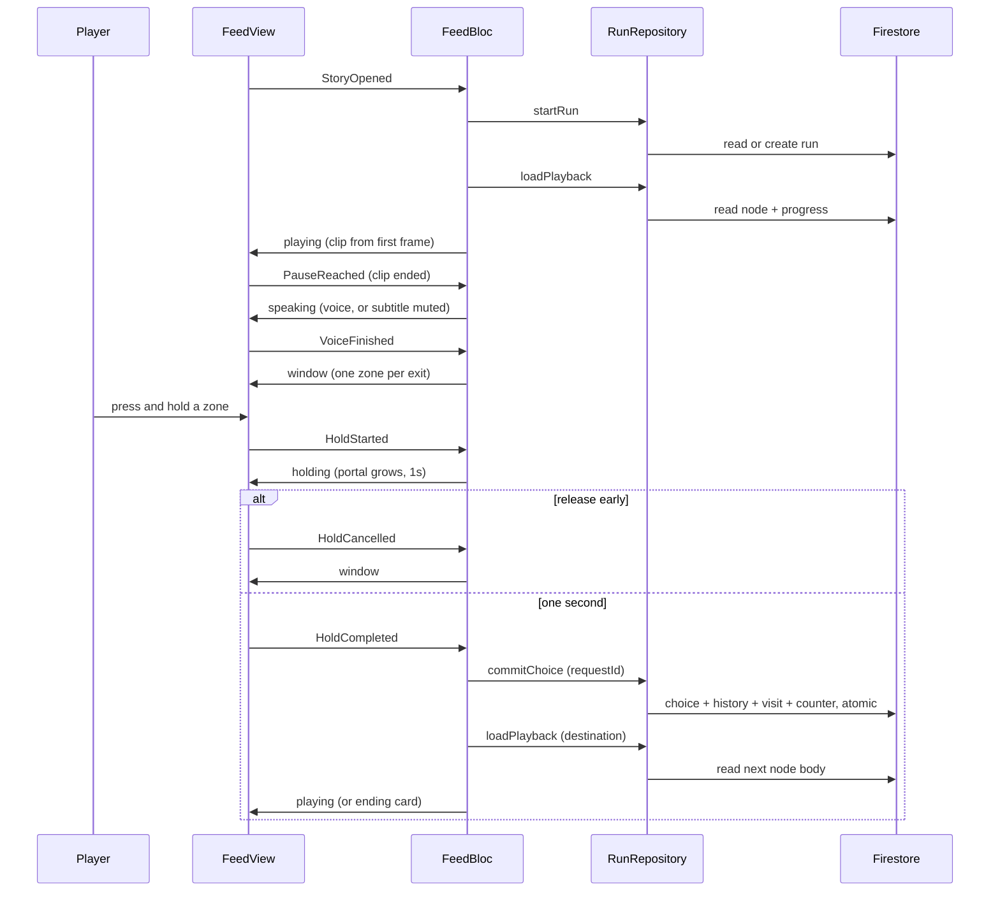
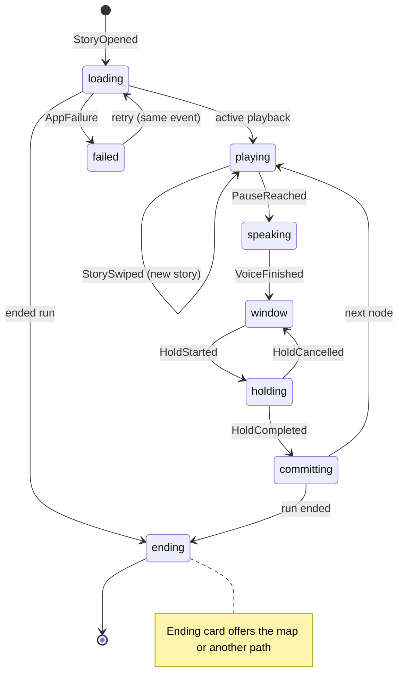
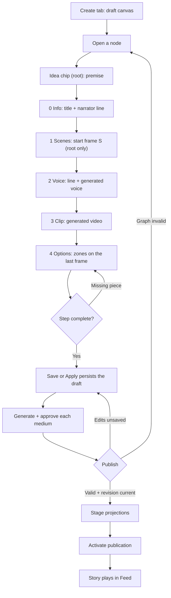
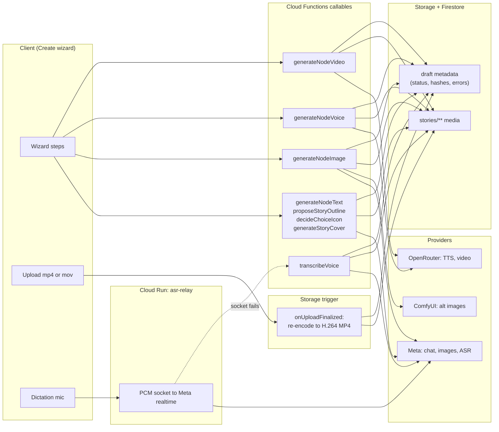
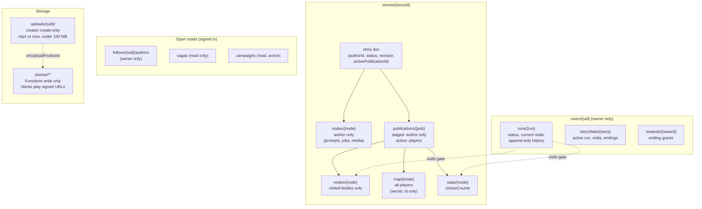
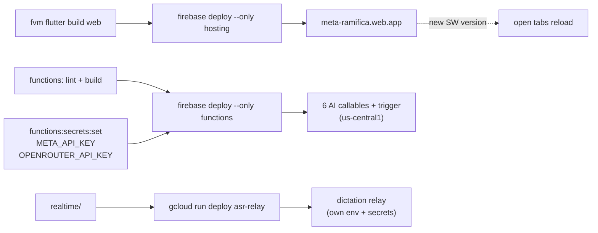

# Flows

Visual overview of Ramifica: the user journey, the play loop, authoring, generation, data, and deployment. Behavior details live in [Architecture](architecture.md); paths in [Data model](data-model.md); models in [AI configuration](ai-configuration.md). Diagrams are Mermaid and render on GitHub.

## User journey

## Play flow

One decision round trip, from the player gesture to the persisted commit. `commitChoice` carries a `requestId` and retries with the same id, so the server never advances twice.

## Feed phases

## Authoring flow

Each node walks the wizard. Continue names the first missing piece until the step is complete; children skip Scenes and inherit the start frame from the parent clip. Full step reference: [Creating stories](creating.md).

## AI generation and media

Eight callables plus one trigger, all in `us-central1`. Formats in [Media pipeline](media-pipeline.md).

## Database

Firestore paths with their readers, plus the Storage layout. Field reference: [Data model](data-model.md); enforcement: [Security](security.md).

## Deploy

